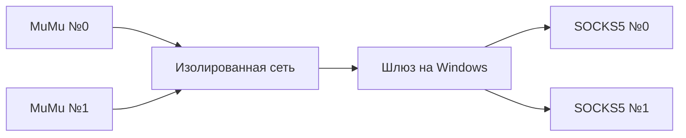

# Отдельный SOCKS5 для каждого MuMu

Прокси работает снаружи Android. Один Linux-шлюз на Windows получает трафик
эмуляторов по выделенному адаптеру `ShortPost-LAN` и выбирает SOCKS5 по
закреплённому адресу каждого устройства. ProxySocket внутри телефона для
этого подключения не нужен.

Для каждого устройства задаются `external_id`, адрес `10.77.0.2–253`, MAC и
отдельная запись SOCKS5. `shortpost_worker.gateway_policy.build()` создаёт
конфигурацию sing-box, правила nftables и DHCP с постоянными привязками.
Неизвестные устройства DHCP-адрес не получают. DNS идёт по HTTPS через прокси
соответствующего устройства. IPv6 в интернет не пропускается.
Из Android в TUN разрешены только TCP и UDP; прочие IP-протоколы, включая
интернет-ICMP, блокируются, поскольку обычный SOCKS5 их не переносит.

В шлюзе нет прямого исходящего маршрута для трафика Android. nftables разрешает
переход только из внутренней сети в TUN; при остановке sing-box остаётся
запрещающий маршрут. В MuMu используется единственная карта в режиме моста,
дополнительные карты NAT отключены. На Windows установлены отдельные правила
запрета внешнего NAT для процессов Android 15 MuMu.

## Установка и состояние

Это операторский модуль для подготовленного ПК, а не самостоятельный
установщик всей сети. Первичная установка требует прав администратора:
создание подписанного TAP-адаптера, установка штатного драйвера моста MuMu,
развёртывание шлюза и закрепление DHCP. Рабочие установленные компоненты:

- QEMU 11.1.0 для Windows, программная виртуализация TCG без включения Hyper-V.
- Официальный Alpine 3.23.7 BIOS/cloud-init и sing-box 1.12.12.
- TAP-Windows 9.27.0, подпись Microsoft Windows Hardware Compatibility Publisher.

QEMU: [официальная страница загрузок](https://www.qemu.org/download/),
[Windows-сборка](https://qemu.weilnetz.de/w64/).
Alpine: [официальные образы](https://alpinelinux.org/cloud/).
TAP: [официальный выпуск OpenVPN](https://github.com/OpenVPN/tap-windows6/releases/tag/9.27.0).
Готовые диски, ключи и конфигурация с паролями в репозиторий не включаются.

Состояние Windows находится в `%ProgramData%\ShortPost\network-gateway`, доступ
ограничен администраторами и SYSTEM. Ключ управления шлюзом имеет отдельные
права. Исходная запись прокси хранится в `%LOCALAPPDATA%\ShortPost\proxy-vault`
через DPAPI текущего пользователя. Сгенерированный `config.json` внутри шлюза
содержит пароль и должен оставаться доступен только root (`0600`).

На шлюзе `eth0` — выход QEMU через Windows, `eth1` — изолированная сеть.
Установите `shortpost-lan` и `shortpost-gateway` в `/etc/init.d`, а результат
генератора — в `/etc/shortpost/config.json`, `/etc/shortpost/guard.nft` и
`/etc/dnsmasq.conf`. Для dnsmasq задаётся `rc_need="shortpost-lan"` в
`/etc/conf.d/dnsmasq`. Эти службы добавляются в OpenRC `default`.

`start_gateway.py`, `verify_adapter.ps1` и `register_gateway_task.ps1` копируются
в защищённую папку Windows. Регистрация задачи выполняется с путём к Python
Worker. Задача `ShortPost Network Gateway` запускает шлюз при входе пользователя
и повторяет запуск после ошибки. Перед запуском проверяются исходный GUID
адаптера, отсутствие основного шлюза Windows на нём и защитные правила.
Первичная запись `adapter.json` создаётся оператором при создании адаптера;
её нельзя подменять данными другого интерфейса.

MuMu настраивается на мост `TAP-Windows Adapter V9` и DHCP. В проверенном
экземпляре Android 15 статическая настройка MuMu не выдавала адрес, поэтому
используется DHCP с закреплением по MAC. Для управления UI и чтения состояния
MuMu команды запускаются в интерактивном сеансе пользователя, не в Session 0.

ADB сохраняет прежний адрес Worker: Windows перенаправляет только
`127.0.0.1:16384` в приватный `10.77.0.10:5555`. Публичный порт ADB не открывается.
Android ID берётся из штатной привязки Worker; ID из Appium device-info может
отличаться из-за области приложения. Автоматически перепривязывать устройство
при несовпадении запрещено.

## Проверка

`python -m shortpost_worker.proxy_probe --proxy-id mumu-01` проверяет запись из
DPAPI-хранилища без изменения маршрутов: авторизацию, HTTPS и реальную передачу
UDP. Принятый UDP ASSOCIATE сам по себе успехом не считается. Отчёт не содержит
учётных данных и отдельно указывает, что маршрутизация устройства не проверена.

Приёмка отдельного эмулятора включает сверку исходного Android ID, адреса
DHCP, единственной карты в режиме моста, внешнего IP по TCP и UDP STUN из
Android. Затем доступ к SOCKS5 временно блокируется на шлюзе: оба запроса должны
перестать проходить, а после снятия блокировки — восстановиться с тем же IP.
Эта проверка выполнена для первого экземпляра. Другие эмуляторы требуют своих
прокси и такой же отдельной проверки.

Проверка сети не включает публикацию роликов и не включает общий live-режим
Worker. При выключенном шлюзе эмулятор остаётся без интернета; переключать его
на обычный NAT для автоматического восстановления нельзя.
